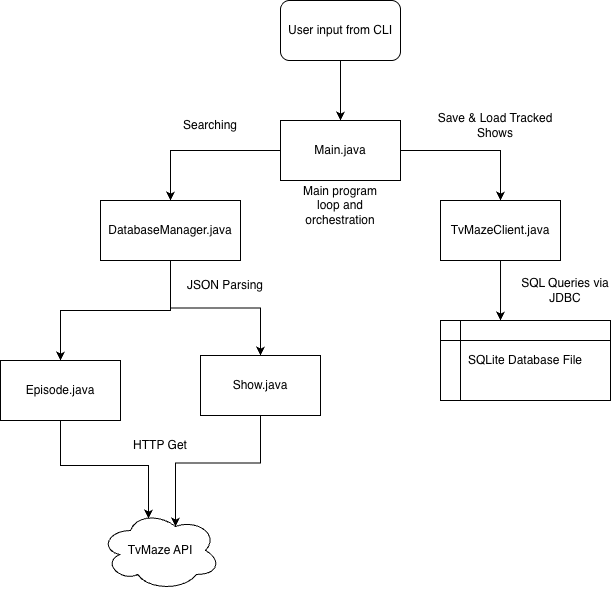

# tv-show-tracker

Enter a TV show, store it in your local database, and view when the next episode releases.

## The Problem

Trouble keeping track of when your favorite TV shows release the next episode? You are not alone. There's so many places to look online.

## How It Works

You enter in a TV show on a command-line interface. The query then gets sent to a client handler which accessess TvMaze's API. A JSON entry is returned. This is then parsed and added to a local database. The user can access this database to view when the next episode releases for each of their shows.



## Tech Stack

- **Language:** Java 21
- **Libraries:** SQLite, Gson, HTTPClient
- **External tools:** TvMaze API

## Setup
```bash
git clone https://github.com/karthkkjr/tv-show-tracker
cd tv-show-tracker
```

## Usage

Open up your favorite Java IDE. Make sure you are running Java 21. Run Main.java.

## Roadmap


- [ ] App with GUI 
- [ ] Yearly schedule for individual shows
- [ ] Live episode countdown

## Author

Karthikeya Atmakuru

Github: [karthkkjr](https://github.com/karthkkjr)
